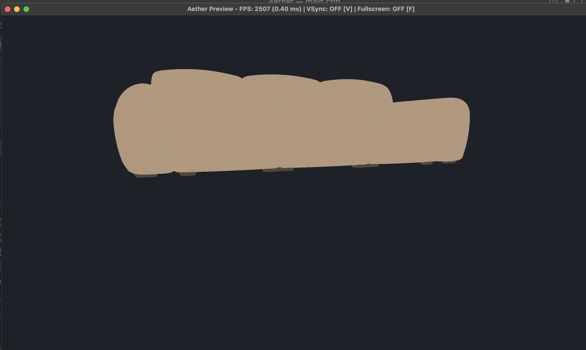

# Aether

A small, lightweight 3D game engine written in **C++17** on top of **OpenGL 3.3 Core** and **GLFW**.



Aether gives you the core building blocks of a game: a window and render loop, input, timing, an asset manager, scenes with a camera, and a component-based `GameObject` system with basic rendering and physics components.

---

## Features

| Module | What it does |
|---|---|
| **Core** (`Aether.hpp`) | `Aether::Init()` / `Aether::Shutdown()` bring up and tear down every subsystem in the correct order. Global access via `Aether::window`, `input`, `time`, `sceneManager`, `assetManager`. |
| **Window** | GLFW window + OpenGL 3.3 Core context, VSync control, fullscreen toggle, automatic viewport resize. |
| **Input** | Keyboard and mouse buttons with *hold / pressed / released* states, mouse position and delta, scroll wheel, cursor locking. |
| **Time** | Per-frame delta time with a configurable clamp to avoid huge steps after stalls. |
| **Assets** | `AssetManager` loads and caches shaders, textures and meshes by name (shared ownership via `std::shared_ptr`). |
| **Rendering** | `Shader` (GLSL compile/link + uniform setters), `Texture` (PNG/JPG via stb_image, mipmaps), `Mesh` (VAO/VBO/EBO), `MeshRenderer` component, white fallback texture. |
| **OBJ loading** | Fast, zero-temporary-allocation Wavefront `.obj` parser: positions, UVs, normals, negative indices, polygon faces (fan-triangulated). |
| **Scenes** | `SceneManager` with deferred scene switching; `Scene` owns its `GameObject`s and a `Camera`. Adding/removing objects during an update is safe. |
| **Camera** | FPS-style perspective camera: yaw/pitch mouse look, keyboard movement, FOV zoom. |
| **Components** | `GameObject` + `Component` system with fast type-ID lookup (`AddComponent<T>()`, `GetComponent<T>()`). |
| **Physics** | `RigidBody` (gravity, forces, impulses, damping, mass, terminal velocity, kinematic mode) and `BoxCollider` (AABB overlap tests). |
| **Math** | Self-contained `Vec2`, `Vec3`, `Mat4` (translate/rotate/scale, LookAt, Perspective) — no external math library needed. |

---

## Project structure

```
Aether/
├── include/Aether/   # Public engine headers
├── src/              # Engine implementation
├── libs/
│   ├── glad/         # OpenGL function loader
│   └── stb_image/    # Image loading
├── preview/          # Demo / test program (model viewer)
├── image/            # Documentation screenshots / assets
├── CMakeLists.txt
├── run.sh            # Configure, build and run
└── runc.sh           # Clean build (deletes build/) and run
```

---

## Building

### Requirements
- A C++17 compiler (Clang, GCC or MSVC)
- CMake ≥ 3.14
- OpenGL 3.3 capable GPU / driver
- GLFW 3.3+ — **optional**. If CMake finds an installed GLFW it uses it; otherwise it automatically downloads and builds GLFW 3.4 from GitHub (requires `git` and an internet connection on the first configure).

On macOS with Homebrew:

```bash
brew install cmake glfw   # glfw is optional
```

On Debian/Ubuntu:

```bash
sudo apt install build-essential cmake libglfw3-dev
```

> If you skip `libglfw3-dev` on Linux, GLFW is built from source and needs the windowing development packages instead, e.g. `libx11-dev libxrandr-dev libxinerama-dev libxcursor-dev libxi-dev` and `libwayland-dev libxkbcommon-dev wayland-protocols`.

### Build and run

```bash
cmake -B build
cmake --build build
./build/Aether
```

The build type defaults to **Release**. For a debug build use `cmake -B build -DCMAKE_BUILD_TYPE=Debug`.

Or use the helper scripts:

```bash
./run.sh    # incremental build + run
./runc.sh   # clean rebuild + run
```

---

## Preview (test program)

The `preview/` folder contains a small model viewer that exercises the engine end to end: it loads a high-poly OBJ model and its texture through the `AssetManager`, puts it in a scene with a `MeshRenderer`, and lets you fly around it with the camera.

| File | Purpose |
|---|---|
| `main.cpp` | The viewer program |
| `vertex.glsl` / `fragment.glsl` | Shaders: texture sampling + simple two-light diffuse shading |
| `model.obj` | Test model (~172k vertices, ~300k triangles) |
| `texture_0.png` | 2048×2048 texture for the model |

CMake copies the `preview/` folder next to the executable after every build, so asset paths work when you run `./build/Aether`.

### Controls

| Key | Action |
|---|---|
| Mouse | Look around |
| `W` `A` `S` `D` | Move |
| `Space` | Move up |
| `Left Ctrl` / `C` | Move down |
| `Left Shift` | Move faster |
| Scroll wheel | Zoom (FOV) |
| `F` | Toggle fullscreen |
| `V` | Toggle VSync |
| `R` | Reset camera |
| `Esc` | Leave fullscreen / quit |

The window title shows the current FPS and frame time.

### Using your own model

Replace `preview/model.obj` and `preview/texture_0.png`, or change the paths in `preview/main.cpp`. The model should have UVs (`vt`) for the texture to map correctly, and normals (`vn`) for lighting. You may need to adjust the starting camera position for models of a different size.

---

## Minimal example

```cpp
#include "Aether/Aether.hpp"
#include "Aether/meshRenderer.hpp"

int main()
{
    if (!Aether::Init(1280, 720, "My Game"))
        return -1;

    // Scope block guarantees all GPU resources (shaders, textures, meshes, scene objects)
    // are cleanly destroyed via RAII before Aether::Shutdown() terminates the OpenGL context.
    {
        auto shader  = Aether::assetManager.LoadShader("basic", "shaders/vertex.glsl", "shaders/fragment.glsl");
        auto texture = Aether::assetManager.LoadTexture("crate", "textures/crate.png");
        auto mesh    = Aether::assetManager.LoadMesh("crate", "models/crate.obj");

        auto scene = Aether::sceneManager.CreateScene("Main");
        Aether::sceneManager.LoadScene(scene);

        auto crate = scene->AddObject("Crate");
        auto* renderer = crate->AddComponent<Aether::MeshRenderer>();
        renderer->mesh    = mesh;
        renderer->shader  = shader;
        renderer->texture = texture;

        glEnable(GL_DEPTH_TEST);

        while (!Aether::window.ShouldClose())
        {
            Aether::time.Update();
            Aether::window.PollEvents();

            crate->GetTransform().rotation.y += 45.0f * Aether::time.GetDeltaTime();

            Aether::sceneManager.Update();

            glClear(GL_COLOR_BUFFER_BIT | GL_DEPTH_BUFFER_BIT);
            Aether::sceneManager.Render();

            Aether::input.Update();
            Aether::window.SwapBuffers();
        }
    }

    Aether::Shutdown();
    return 0;
}
```

> **Note:** Enclosing resource declarations in a scoped block `{ ... }` (or explicitly calling `.reset()` before shutdown) ensures that all `shared_ptr` handles to GPU resources (meshes, textures, shaders, scenes) are destroyed via RAII while the OpenGL context is still valid, preventing undefined behavior during context termination.

---

## Current limitations

- `.mtl` material files are not parsed — assign textures manually through `MeshRenderer`.
- The scene loop has no separate fixed-timestep physics pass yet; `RigidBody` steps from the regular `Update()`.
- `BoxCollider` only detects overlaps (axis-aligned); there is no collision response yet.
- The OpenGL renderer runs on macOS, but Apple has deprecated OpenGL there.

---

## Third-party libraries

- [GLFW](https://www.glfw.org/) — windowing and input (zlib/libpng license)
- [glad](https://github.com/Dav1dde/glad) — OpenGL loader
- [stb_image](https://github.com/nothings/stb) — image loading (public domain / MIT)

---

## License

Aether is released under the [MIT License](LICENSE).

